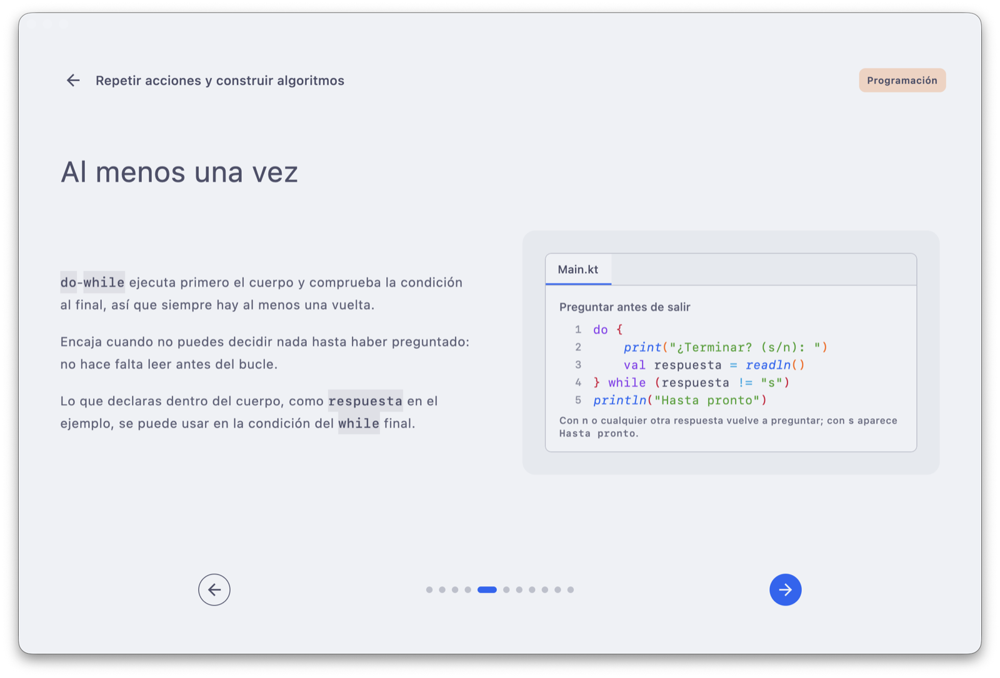
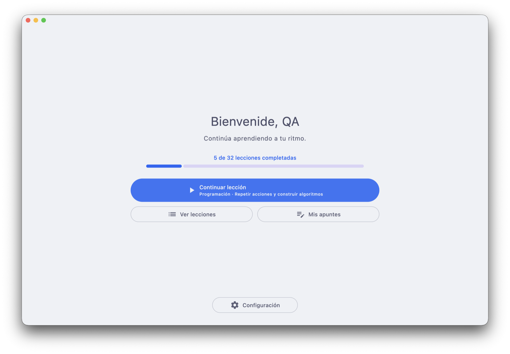
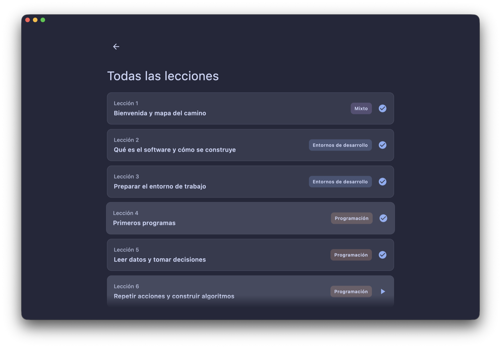

<div align="center">

# init

**Aprende a programar desde cero, paso a paso, con Kotlin.**

Una aplicación de escritorio con un itinerario guiado de lecciones cortas, ejemplos visuales y prácticas,<br>
inspirada en la programación de primero de Desarrollo de Aplicaciones Multiplataforma (DAM).

[](https://github.com/kuromiichi/init/releases/latest)
[](https://github.com/kuromiichi/init/actions/workflows/verify.yml)


[**Descargar**](#descargar) · [Itinerario](#itinerario) · [Enfoque didáctico](#enfoque-didáctico) · [Desarrollo](#desarrollo)



</div>

<table>
  <tr>
    <td width="50%"></td>
    <td width="50%"></td>
  </tr>
  <tr>
    <td align="center"><sub>Portada: tu progreso y la siguiente lección</sub></td>
    <td align="center"><sub>Itinerario lineal, también en tema oscuro</sub></td>
  </tr>
</table>

## Qué es init

init es una tutoría guiada para aprender a programar sin conocimientos previos. Cada lección se divide en pantallas breves que presentan una idea cada vez, con ejemplos de código, esquemas y prácticas para comprobar lo aprendido.

Los contenidos se seleccionan tomando como referencia la programación de primero de **DAM**, sin pretender preparar el ciclo completo. El centro es **Programación**, apoyada cuando hace falta en Entornos de Desarrollo, Sistemas Informáticos, Bases de Datos y Lenguajes de Marcas.

- Introduce la programación sin dar nada por sabido.
- Relaciona cada concepto con las herramientas de un entorno real: Kotlin sobre la JVM, IntelliJ IDEA, Gradle y Git.
- Avanza desde los fundamentos hasta la orientación a objetos, las colecciones, las pruebas, las interfaces y un proyecto aplicado.
- Mantiene la relación con los resultados de aprendizaje y criterios de evaluación del currículo oficial de DAM.

init no reproduce literalmente ningún temario ni sigue necesariamente su orden: los contenidos se seleccionan, reorganizan y adaptan al formato de la aplicación.

## Descargar

> [!NOTE]
> init está en **beta** (versiones `0.x`): puede tener errores y cambiar con frecuencia. La app avisa de cada versión nueva y se actualiza conservando tu progreso.

Descarga el instalador de tu sistema desde la [**última release**](https://github.com/kuromiichi/init/releases/latest):

| Sistema | Archivo |
| --- | --- |
| macOS con Apple Silicon (M1 o posterior) | `init-<versión>-macos-arm64.dmg` |
| macOS con Intel | `init-<versión>-macos-x64.dmg` |
| Windows 10 u 11 (x64) | `init-<versión>-windows-x64.msi` |
| Linux x64 (Debian, Ubuntu y derivadas) | `init-<versión>-linux-x64.deb` |

Los instaladores todavía no están firmados, así que la primera vez el sistema pide confirmación:

<details>
<summary><b>macOS</b></summary>

Abre el `.dmg` y arrastra **init** a *Aplicaciones*. Si al abrirla macOS indica que no puede comprobar el desarrollador, ve a *Ajustes del Sistema → Privacidad y seguridad* y pulsa *Abrir igualmente*. Solo hace falta la primera vez.
</details>

<details>
<summary><b>Windows</b></summary>

Ejecuta el `.msi`. Si aparece *Windows protegió su PC*, pulsa *Más información → Ejecutar de todas formas*. Se instala para tu usuario, sin permisos de administrador.
</details>

<details>
<summary><b>Linux</b></summary>

Abre el `.deb` con el instalador de software de tu distribución o instálalo desde la terminal:

```bash
sudo apt install ./init-<versión>-linux-x64.deb
```
</details>

Tus datos (nombre, ajustes y progreso) se guardan fuera de la instalación y se mantienen al actualizar. Desde *Configuración* puedes exportarlos a un archivo para hacer una copia o llevarlos a otro equipo.

## Características

- **Itinerario lineal** de 32 lecciones con desbloqueo secuencial; las que aún no se pueden abrir explican por qué.
- **Pasos breves** con texto enriquecido, ejemplos de Kotlin resaltados, tablas de traza, salidas de consola, esquemas, capturas de herramientas y diagramas UML.
- **Prácticas guiadas** con requisitos, resultado esperado en forma de consola, pistas progresivas y ampliación opcional.
- **Progreso persistente**: una lección a medias se retoma en el último paso y una completada se repasa sin alterar el avance.
- **Instrucciones por sistema operativo** (macOS, Windows o Linux) en las lecciones de entorno y terminal.
- **Todo con teclado**: flechas, Tab, Intro y Escape en todas las pantallas.
- **Temas claro, oscuro o del sistema**, y tratamiento personalizable en los saludos.
- **Copias de seguridad** en JSON desde Configuración y desde la configuración inicial.
- **Actualizaciones integradas** desde GitHub Releases, con comprobación de integridad.

## Itinerario

Hay contenido disponible hasta la lección 18; el resto del recorrido está planificado y se irá publicando.

<details>
<summary><b>Lecciones disponibles (18 de 32)</b></summary>

1. Bienvenida y mapa del camino
2. Qué es el software y cómo se construye
3. Preparar el entorno de trabajo
4. Primeros programas
5. Leer datos y tomar decisiones
6. Repetir acciones y construir algoritmos
7. Entender errores y depurar
8. Funciones y modularidad
9. La terminal y el sistema de ficheros
10. Control de versiones con Git
11. Pruebas básicas de software
12. Valores nulos, errores y excepciones
13. Estructuras de almacenamiento I: arrays y listas
14. Estructuras de almacenamiento II: conjuntos y mapas
15. Programación orientada a objetos I: clases y objetos
16. Programación orientada a objetos II: relaciones y composición
17. Programación orientada a objetos III: herencia e interfaces
18. UML: diagramas de clases
</details>

<details>
<summary><b>Próximamente</b></summary>

19. Programación funcional aplicada
20. Genéricos, abstracciones y colecciones avanzadas
21. Código limpio y refactorización
22. SOLID, patrones y arquitectura básica
23. Gradle y dependencias
24. Leer y escribir ficheros
25. JSON, XML y formatos de intercambio
26. Diseñar datos: modelo E/R y normalización
27. SQL I: crear tablas y manipular datos
28. SQL II: consultas con varias tablas
29. Usar una base de datos desde Kotlin
30. Interfaces gráficas
31. Desarrollo iterativo y organización del proyecto
32. Proyecto aplicado
</details>

La pantalla de apuntes todavía está pendiente.

## Enfoque didáctico

Cada lección se divide en pantallas cortas. La intención es presentar una idea importante cada vez y combinar:

- explicación conceptual;
- vocabulario técnico contextualizado;
- ejemplos de código;
- esquemas y recorridos visuales;
- uso gradual de herramientas profesionales;
- actividades prácticas para comprobar lo aprendido.

Cuando el contenido lo permite, la lección termina con una práctica estructurada que presenta su objetivo, enunciado, requisitos mínimos, resultado esperado, pistas y una ampliación opcional. Las materias de apoyo se integran en un único recorrido: clasifican y contextualizan las lecciones, pero no crean caminos alternativos.

El orden de init responde a esta progresión didáctica propia. Por ello puede diferir tanto del orden de las fuentes de referencia como de la distribución utilizada por un centro educativo concreto.

## Fuentes y marco curricular

Las referencias didácticas principales del proyecto son:

- [Programación 1DAM, curso 2022/2023, de José Luis González Sánchez](https://github.com/joseluisgs/Programacion-00-2022-2023).
- [Entornos de Desarrollo 1DAM, curso 2022/2023, de José Luis González Sánchez](https://github.com/joseluisgs/EntornosDesarrollo-00-2022-2023).

Estos materiales organizan contenidos de Programación y Entornos de Desarrollo para primero de DAM y relacionan el temario con sus resultados de aprendizaje. init los utiliza como orientación, pero adapta la selección, la redacción, el orden y la presentación a su propio formato.

Como marco curricular oficial se consultan:

- [Real Decreto 450/2010, de 16 de abril](https://www.boe.es/buscar/doc.php?id=BOE-A-2010-8067), por el que se establece el título de Técnico Superior en Desarrollo de Aplicaciones Multiplataforma y sus enseñanzas mínimas.
- [Real Decreto 405/2023, de 29 de mayo](https://www.boe.es/buscar/doc.php?id=BOE-A-2023-13221), que actualiza los módulos profesionales y las enseñanzas mínimas de DAM.
- [Orden EDU/2000/2010, de 13 de julio](https://www.boe.es/buscar/doc.php?id=BOE-A-2010-11888), por la que se establece el currículo del ciclo formativo en el ámbito de gestión del Ministerio de Educación.
- [Orden EFD/659/2024, de 25 de junio](https://www.boe.es/eli/es/o/2024/06/25/efd659), que actualiza la organización y distribución curricular en el ámbito de gestión del Ministerio.

Para los detalles técnicos se prioriza, cuando corresponde, la documentación oficial de las herramientas utilizadas, como [Kotlin](https://kotlinlang.org/docs/home.html), [IntelliJ IDEA](https://www.jetbrains.com/help/idea/getting-started.html), [Gradle](https://docs.gradle.org/current/userguide/userguide.html) y [Git](https://git-scm.com/doc).

### Atribución del material educativo

El repositorio de referencia de José Luis González Sánchez está publicado bajo la licencia [Creative Commons Reconocimiento-NoComercial-CompartirIgual 4.0 Internacional](https://creativecommons.org/licenses/by-nc-sa/4.0/deed.es). Los contenidos educativos de init que adapten ese material deben conservar la atribución, el uso no comercial y las mismas condiciones de licencia.

El código fuente de init no tiene todavía una licencia publicada. Esta distinción deberá conservarse al preparar una distribución pública del proyecto.

## Desarrollo

### Tecnologías

| Ámbito | Herramientas |
| --- | --- |
| Lenguaje e interfaz | Kotlin/JVM, Compose Multiplatform para escritorio, Material 3 |
| Navegación y estado | Navigation Compose con rutas tipadas, ViewModels de AndroidX Lifecycle |
| Datos | DataStore Preferences, Room sobre SQLite, kotlinx.serialization |
| Inyección de dependencias | Koin, incluidos los ViewModels |
| Compilación | Gradle con Kotlin DSL, KSP, toolchain de Java 25 |
| Calidad | Kotlin Test sobre JUnit Platform, pruebas de interfaz de Compose, ktlint |

### Ejecutar el proyecto

El repositorio incluye Gradle Wrapper, así que no hace falta instalar Gradle. En macOS o Linux:

```bash
./gradlew run
```

En Windows:

```powershell
gradlew.bat run
```

También se puede abrir el proyecto con IntelliJ IDEA y ejecutar la configuración principal de la aplicación.

### Verificación

Ejecutar las pruebas:

```bash
./gradlew test
```

Compilar y verificar el proyecto completo desde cero (compilación, pruebas y estilo):

```bash
./gradlew --stop
./gradlew --no-daemon clean build
```

Aplicar automáticamente el formato acordado:

```bash
./gradlew ktlintFormat
```

Si una compilación se queda detenida sin avanzar, suele deberse a salidas previas en `build/`: basta con detenerla, ejecutar `./gradlew --stop` y repetir la tarea precedida de `clean`.

### Instaladores

```bash
./gradlew packageDistributionForCurrentOS
```

Compose Desktop no genera instaladores para otro sistema: cada paquete se construye en su plataforma, que es lo que hace el workflow de releases. Si macOS rechaza la firma porque la carpeta está gestionada por un servicio de sincronización, se puede dirigir solo la salida a una carpeta local:

```bash
./gradlew packageDistributionForCurrentOS -PnativeDistributionOutput=/private/tmp/init-distribution
```

### Versiones y releases

Las versiones siguen [SemVer](https://semver.org/lang/es/) y se publican con un tag `vMAJOR.MINOR.PATCH` sin sufijos. Mientras la versión mayor sea 0 la app se considera beta y lo indica en Configuración; `1.0.0` queda para la primera versión estable.

```bash
git tag v0.1.0
git push origin v0.1.0
```

El workflow [`Release`](.github/workflows/release.yml) verifica el proyecto, construye los instaladores (dmg para macOS arm64 y x64, msi para Windows x64 y deb para Linux x64), calcula `SHA256SUMS` y publica la release con los cambios `feat` y `fix` desde el tag anterior.

La app consulta la última release al iniciarse (se puede desactivar en Configuración) y, si es más nueva, muestra un botón en la portada. Antes de instalar comprueba el SHA-256 del instalador:

- **macOS**: sustituye la app al cerrarla y la vuelve a abrir. Si no tiene permiso de escritura en su carpeta, abre la imagen para instalarla a mano.
- **Windows**: el MSI, por usuario y sin administrador, sustituye la versión anterior gracias a su `upgradeUuid` fijo.
- **Linux**: abre el paquete en el instalador del sistema.

macOS exige que la versión del paquete empiece por 1 o más, así que durante la etapa 0.x el `.app` lleva internamente `1.0.<nº de commits>`; la versión visible es siempre la del tag. Las ejecuciones con `./gradlew run` no tienen versión (`dev`) y no buscan actualizaciones. Las migraciones de Room y los identificadores estables de las lecciones mantienen el progreso entre versiones.

### Estructura principal

```text
src/main/kotlin/dev/kuromiichi/init/
├── data/
│   ├── backup/        Exportación e importación de datos en JSON
│   ├── lessons/       Catálogo, modelos, contenidos y resaltado de ejemplos de Kotlin
│   ├── local/         Directorio de datos de la aplicación
│   ├── preferences/   Preferencias persistentes del usuario
│   ├── progress/      Base Room y repositorio de progreso
│   └── update/        Versión instalada, releases de GitHub e instalación por sistema
├── di/                Módulos de Koin: datos y ViewModels
├── ui/
│   ├── common/        Componentes compartidos y visuales didácticos
│   ├── home/          Portada y resumen de progreso
│   ├── lessons/       Listado y reproducción de lecciones
│   ├── navigation/    Rutas y navegación de la aplicación
│   ├── notes/         Área de apuntes, todavía provisional
│   ├── onboarding/    Configuración inicial
│   ├── settings/      Preferencias, copias de seguridad y actualizaciones
│   ├── theme/         Sistema visual
│   ├── update/        Diálogo y estado de las actualizaciones
│   └── window/        Adaptación al tamaño de ventana
└── App.kt             Composición principal de la aplicación
```

Los recursos gráficos están en `src/main/composeResources/drawable`, las pruebas en `src/test/kotlin` y las capturas de este documento en `docs/screenshots`.

### Arquitectura

La aplicación sigue las guías de arquitectura de Android adaptadas a escritorio:

- Cada pantalla obtiene su `ViewModel` con `koinViewModel()` y observa un único `StateFlow` de estado mediante `collectAsStateWithLifecycle()`.
- Los ViewModels producen el estado combinando los flujos de los repositorios con `stateIn(WhileSubscribed(5_000))`, sin lanzar trabajo en `init`. Los eventos de un solo uso, como terminar una lección, se exponen como estado.
- Los repositorios escriben en un ámbito de corrutinas de aplicación inyectado, de modo que el progreso se guarda aunque la pantalla se cierre justo después. El actualizador también trabaja en ese ámbito y comparte su estado entre la portada y Configuración.
- La lección abierta recibe su identificador de la ruta tipada mediante `SavedStateHandle.toRoute()`.

### Escribir contenido

Cada lección es un `LessonContent` en `data/lessons/contents`, identificado con el mismo id que su entrada en `LessonCatalog`. Los ejemplos de código se escriben como Kotlin normal y se resaltan automáticamente:

```kotlin
lines =
    kotlinCode(
        $$"""
            fun main() {
                val nombre = readln()
                println("Hola, $nombre")
            }
        """.trimIndent(),
    ),
```

El prefijo `$$` hace que `$nombre` se muestre tal cual en lugar de interpolarse. El resultado esperado de una práctica se describe con `consoleRun(consoleInput(...), consoleOutput(...))`. Para seguir un bucle vuelta a vuelta, `LessonVisualContent.Trace` muestra un ejemplo junto a su `LessonTraceTable`; `LessonVisualContent.Console` muestra una salida de consola, con `consoleError` para las trazas de error. Un ejemplo con `isCopyable = true` ofrece un botón para copiar el programa completo.

Cada paso se explica con bloques (`paragraph`, `steps`, `callout`, `explanationCode`); para texto sin formato basta `paragraphs("…", "…")`. En el texto enriquecido se sigue esta convención:

- `inlineCode`: código, nombres de archivos, comandos, rutas, paquetes y formatos (`Main.kt`, `git --version`, `/opt`, `MSI`).
- `emphasis`: etiquetas de la interfaz de IntelliJ IDEA o del sistema operativo (*New Project*, *Add sample code*, *Aplicaciones*) y palabras que se quieren resaltar.
- `highlight`: la idea principal de un párrafo o el objetivo de una práctica.

Las pruebas de `LessonContentRulesTest` comprueban reglas generales del contenido, como variantes completas por sistema operativo, prácticas verificables, que no se muestre trazabilidad curricular al alumno o que una lección no use construcciones que se enseñan más adelante. Validan la estructura y el alcance, no la redacción.

## Próximos pasos

1. Desarrollar las lecciones restantes, empezando por programación funcional, manteniendo la progresión lineal.
2. Documentar la relación entre cada lección, sus fuentes y los resultados de aprendizaje correspondientes.
3. Implementar apuntes persistentes sobre la base de datos local.
4. Firmar los instaladores de macOS y Windows para evitar los avisos de la primera instalación.

## Contribución

El proyecto todavía está definiendo su modelo de contenidos y su alcance. Antes de añadir una lección conviene comprobar:

- qué objetivo didáctico persigue;
- con qué resultado de aprendizaje o criterio curricular se relaciona;
- qué fuentes se han utilizado;
- qué conocimientos previos necesita;
- qué actividad permitirá comprobar que el concepto se ha entendido.

El flujo de trabajo con agentes de IA y las comprobaciones previas a cada cambio se describen en [CLAUDE.md](CLAUDE.md).
